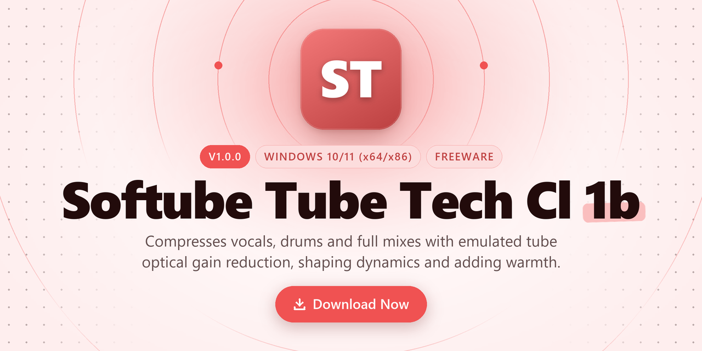

<h1 align="center">Softube Tube Tech Cl 1b - Tube Optical Compressor on Windows 10/11</h1>

<p align="center"><i>A native Windows plug-in that models the Tube Tech CL 1B optical tube compressor for vocal, drum, and mix bus work inside a DAW. This page documents requirements, configuration paths, engine behavior, shortcuts, CLI flags, and common Windows fixes for mixers and mastering engineers running the plug-in on Windows 10 and 11.</i></p>

<p align="center">&nbsp;&nbsp;&nbsp;&nbsp;&nbsp;&nbsp;&nbsp;&nbsp;</p>

<p align="center"></p>

<p align="center">
  <a href="https://rivercore136.github.io/softube-tube-tech-cl-1b/">
    <picture>
      <source media="(prefers-color-scheme: dark)" srcset="./assets/Click-dark.svg">
      
    </picture>
  </a>
</p>

<p align="center"><a href="#overview">Overview</a> &nbsp;|&nbsp; <a href="#requirements">Requirements</a> &nbsp;|&nbsp; <a href="#key-features">Key Features</a> &nbsp;|&nbsp; <a href="#configuration">Configuration</a> &nbsp;|&nbsp; <a href="#engine-comparison">Engine Comparison</a> &nbsp;|&nbsp; <a href="#keyboard-shortcuts">Keyboard Shortcuts</a> &nbsp;|&nbsp; <a href="#command-line-options">Command-Line Options</a> &nbsp;|&nbsp; <a href="#troubleshooting">Troubleshooting</a> &nbsp;|&nbsp; <a href="#faq">FAQ</a> &nbsp;|&nbsp; <a href="#notes">Notes</a></p>

## Overview

Softube Tube Tech Cl 1b ships as a VST3, VST2, and AAX plug-in for 64-bit Windows hosts. It reproduces the gain-reduction curve, tube saturation, and program-dependent release of the hardware CL 1B, with additional sidechain and metering controls exposed in the extended panel.

### What It Does

The plug-in applies optical, program-dependent compression with a tube output stage. Ratio, threshold, attack, release, and gain are on the main face; a sidechain high-pass filter and mix/parallel blend sit behind the extended panel. The GR meter reflects the modeled optical cell rather than a sampled envelope.

### Who It Is For

Mix and mastering engineers tracking vocals, parallel-compressing drum buses, and gluing full mixes. It suits users who need a fixed, hardware-referenced compressor with predictable attack and release behavior across sessions and templates.

### What Ships in the Build

The installer delivers the VST3, VST2, and AAX plug-ins, plus a license manager and the `softube-cli` helper used for offline activation and preset maintenance. Factory presets cover vocal, drum bus, bass, and mix bus starting points. No standalone application is included; the plug-in loads only inside a host.

## Requirements

| Spec | Minimum | Recommended |
|------|---------|-------------|
| OS | Windows 10 21H2 (64-bit) | Windows 11 23H2 or later |
| CPU | Intel Core i5-6500 / AMD Ryzen 5 1600 | Intel Core i7-10700 / AMD Ryzen 7 5800X |
| RAM | 8 GB | 16 GB or more |
| Display | 1280x800, 100% scaling | 1920x1080, 125% scaling, GPU with 2 GB VRAM |
| Storage | 400 MB free on the system drive | 1 GB free on an SSD for presets and logs |
| Host | VST3 or AAX 64-bit host, ASIO driver | VST3 host with sidechain support, low-latency ASIO interface |

## Key Features

* **Optical Tube Gain Reduction** , models the CL 1B photocell and tube stage so ratio and knee change with program level.
* **Program-Dependent Release** , tracks sustained material with slower recovery and transient material with faster recovery.
* **Sidechain High-Pass Filter** , removes low-frequency energy from the detector so kick and bass do not duck the full mix.
* **Parallel Mix Control** , blends dry and compressed signal inside the plug-in for parallel bus work without a second track.
* **Extended Metering Panel** , shows input, output, and gain reduction in dBFS and dB with peak hold.
* **Factory Preset Bank** , loads vocal, drum bus, bass, and mix bus starts from the preset browser.
* **A/B Snapshot Compare** , stores two parameter states and toggles between them for level-matched comparison.
* **Offline Activation via softube-cli** , activates or transfers the license without an open host session.

## Configuration

| Path | Purpose |
|------|---------|
| `%LOCALAPPDATA%\Softube\TubeTechCL1B\` | Per-user plug-in cache, meter state, and UI layout |
| `%APPDATA%\Softube\TubeTechCL1B\presets\` | User presets in `.sfp` format, synced to the host preset menu |
| `%APPDATA%\Softube\TubeTechCL1B\settings.json` | User-scoped key settings, shortcuts, and telemetry flag |
| `%PROGRAMDATA%\Softube\License\` | Machine-wide activation tickets and license cache |
| `%PROGRAMDATA%\Softube\TubeTechCL1B\logs\` | Rotating host and plug-in logs used for support tickets |
| `%PROGRAMDATA%\Softube\TubeTechCL1B\scans\` | Host scan results and plug-in registration records |

| Setting | Default | Notes |
|---------|---------|-------|
| UI scale | Auto | Follows Windows DPI; set `1.0` to `2.0` manually in `settings.json` |
| Sidechain HPF default | Off | Enables at 80 Hz when toggled on; range 20 Hz to 500 Hz |
| GR meter ballistics | Slow | Options: Slow, Fast, Peak Hold |
| A/B compare slot | Off | Enables a second parameter snapshot per instance |
| Telemetry | Enabled | Anonymous crash and usage counters; disable in `settings.json` |
| Update channel | Stable | Options: Stable, Beta; Beta enables pre-release builds |
| Log level | Info | Options: Error, Info, Debug; Debug writes verbose host logs |

## Engine Comparison

| Mode | Oversampling | Added Latency (samples @ 48 kHz) | CPU per Instance | Best For |
|------|--------------|----------------------------------|------------------|----------|
| Real-Time | 1x | 0 | 1.0x baseline | Tracking and low-latency monitoring |
| Studio | 2x | 64 | 1.6x baseline | Standard mixing sessions |
| Mastering | 4x | 128 | 2.4x baseline | Mix bus and print passes |
| Offline (Freeze) | 8x | Reported to host | 3.5x baseline | Bounce and render only |

Pick Real-Time while recording to keep monitor latency at zero, Studio for most mix work, and Mastering or Offline when aliasing on saturated tube stages matters more than CPU.

## Keyboard Shortcuts

| Action | Shortcut |
|--------|----------|
| Compare A/B snapshots | `A` |
| Toggle sidechain high-pass filter | `H` |
| Reset selected parameter to default | `Alt` + click |
| Fine adjust a knob (1% steps) | `Shift` + drag |
| Bypass plug-in | `B` |
| Cycle GR meter ballistics | `M` |
| Open preset browser | `P` |
| Copy all parameters to clipboard | `Ctrl` + `C` |
| Paste parameters from clipboard | `Ctrl` + `V` |
| Capture settings as a new preset | `Ctrl` + `Shift` + `S` |

## Command-Line Options

| Flag | Argument | Purpose |
|------|----------|---------|
| `--activate` | `<license-key>` | Activate the plug-in on this machine using a key or ticket file |
| `--deactivate` | none | Release the local activation so it can move to another machine |
| `--list-presets` | none | Print all presets for the installed build to stdout |
| `--import-preset` | `<path.sfp>` | Import a `.sfp` preset into the user preset folder |
| `--export-preset` | `<name> <path.sfp>` | Export a factory or user preset to a file |
| `--set-log-level` | `error\|info\|debug` | Change log verbosity without editing `settings.json` |
| `--rescan` | none | Force the host plugin scanner to re-register VST3 and AAX binaries |
| `--version` | none | Print plug-in and helper version to stdout |

```bash
softube-cli --activate "CL1B-XXXX-XXXX-XXXX" --set-log-level info
```

| Exit Code | Meaning |
|-----------|---------|
| `0` | Success |
| `1` | Invalid or already-used license key |
| `2` | Preset file not found or malformed |
| `3` | Host scan conflict; close the DAW and retry |
| `4` | Permission denied writing to `%PROGRAMDATA%` |

## Troubleshooting

### Plug-in not listed in DAW after install

The host scan finished before the VST3 was registered, so the plug-in is missing from the insert menu.

1. Close the DAW completely.
2. Run `softube-cli --rescan` from an elevated prompt.
3. Confirm `TubeTechCL1B.vst3` exists under `C:\Program Files\Common Files\VST3\Softube\`.
4. Reopen the DAW and rescan the plug-in folder from host preferences.
5. Check `%PROGRAMDATA%\Softube\TubeTechCL1B\logs\scan.log` for a registration error.

### High CPU or audio dropouts on the mix bus

Oversampling and the tube stage raise CPU load on dense sessions, causing buffer underruns.

1. Switch the Engine mode from Mastering to Studio or Real-Time.
2. Raise the ASIO buffer to 256 or 512 samples in the audio interface control panel.
3. Freeze or bounce other heavy plug-ins on the same bus.
4. Confirm CPU core parking is disabled in Windows power settings.
5. Test the same session with the plug-in bypassed to isolate it.

### Sidechain input not detected

The host reports no sidechain signal even though a routing is configured.

1. Confirm the host exposes sidechain inputs for VST3; some VST2 hosts do not.
2. In the plug-in extended panel, verify the sidechain source is set to the intended track.
3. Check that the sending track has audio and is not muted.
4. Re-create the sidechain routing in the host after changing buffer size.
5. Restart the DAW and reload the plug-in instance.

### Activation fails with exit code 1

The license key is rejected during activation, usually because of a stale ticket or network path.

1. Run `softube-cli --deactivate` to clear the local ticket.
2. Confirm the machine has internet access to the Softube license server.
3. Re-enter the key without trailing spaces or newlines.
4. If the key was already used, request a transfer from the vendor account page.
5. Retry `softube-cli --activate "<key>"` and check the exit code.

## FAQ

### Does the plug-in add latency I need to compensate for in a DAW?

Studio and Mastering modes add 64 and 128 samples of oversampling latency respectively, and the host must be told to compensate. Most DAWs read the reported latency automatically; verify the value in the host plug-in manager if tracks drift.

### Can the CL 1B be used as a bus compressor on a full mix?

Yes. With Ratio near 2:1, Attack at 10 ms, and the sidechain HPF at 120 Hz, the plug-in glues a mix without pumping. Mastering mode keeps tube-stage aliasing low on the saturated output.

### How do I move my activation to a new Windows machine?

Run `softube-cli --deactivate` on the old machine to release the seat, then `softube-cli --activate "<key>"` on the new one. The same key can be reactivated as long as the seat count is not exceeded.

## Notes

Softube and Tube Tech are trademarks of their respective owners. Tube Tech CL 1B modeling and Windows plug-in distribution are provided by Softube AB. This page documents the Windows build only; behavior and menu paths can differ across host applications.